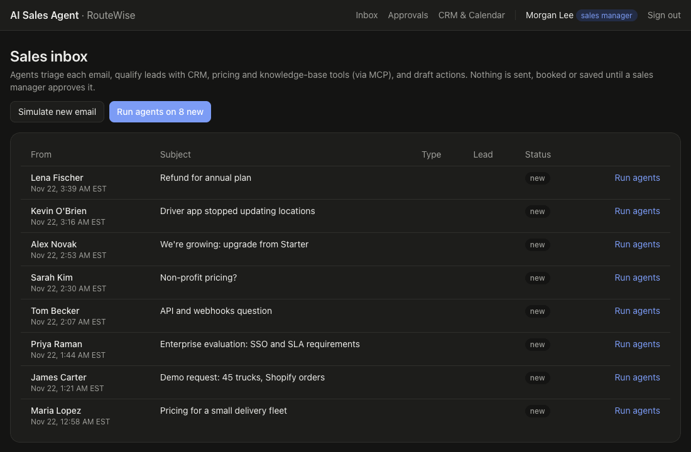
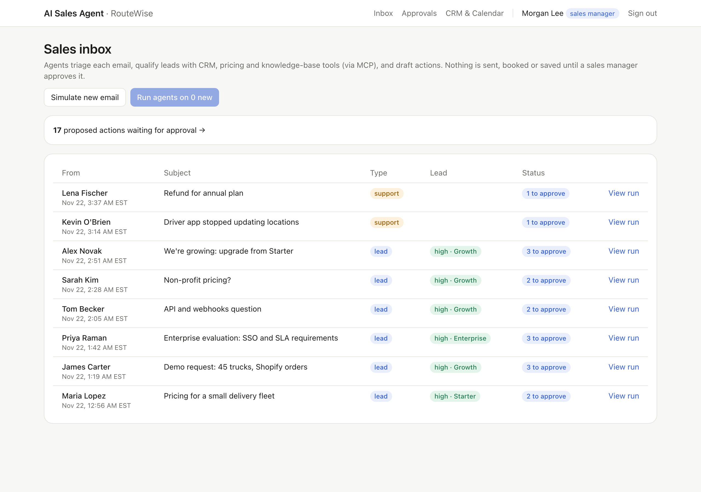
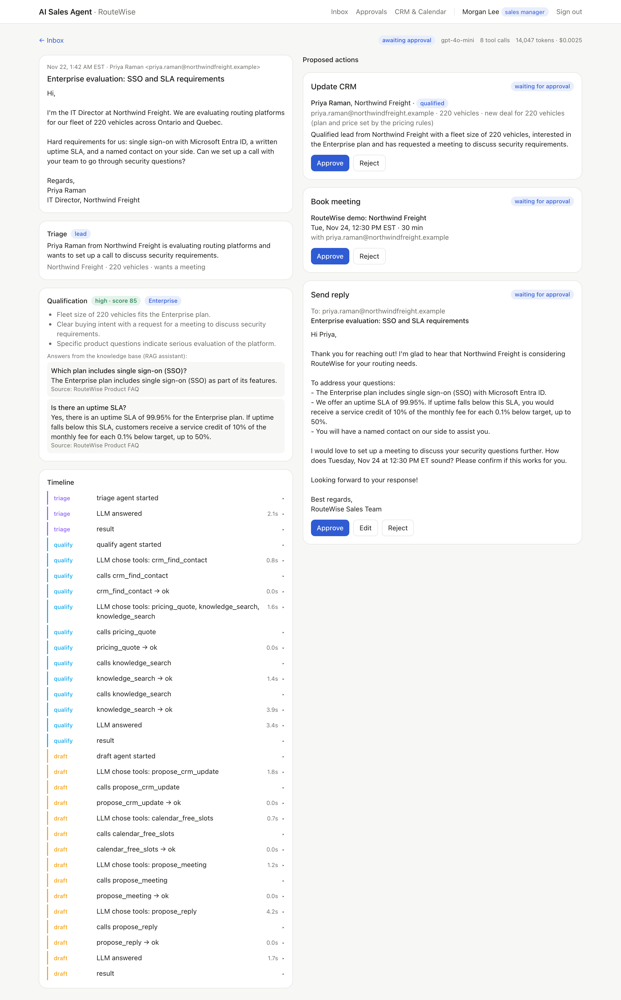
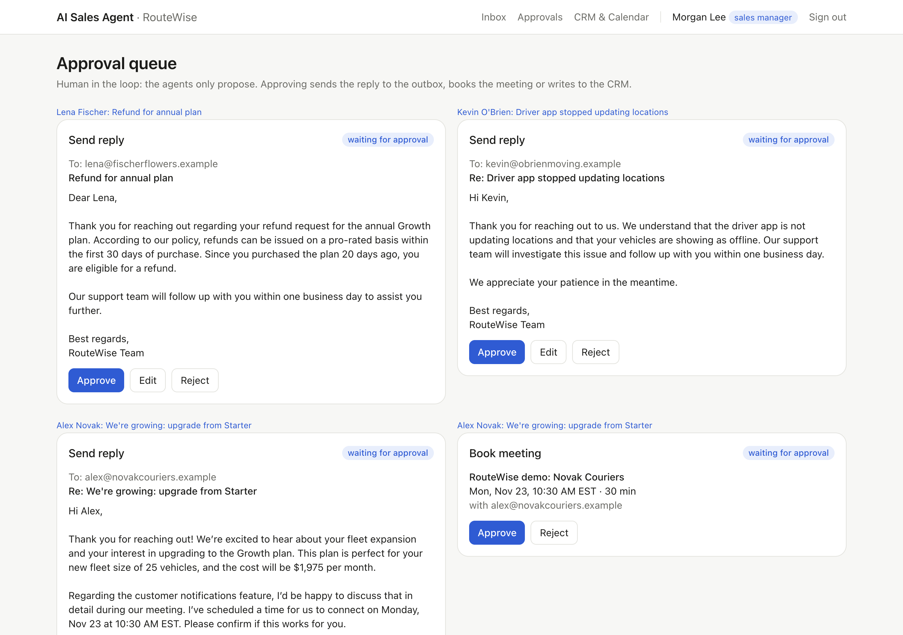
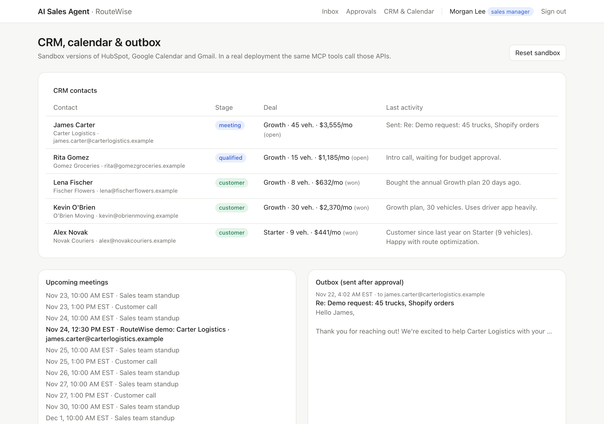
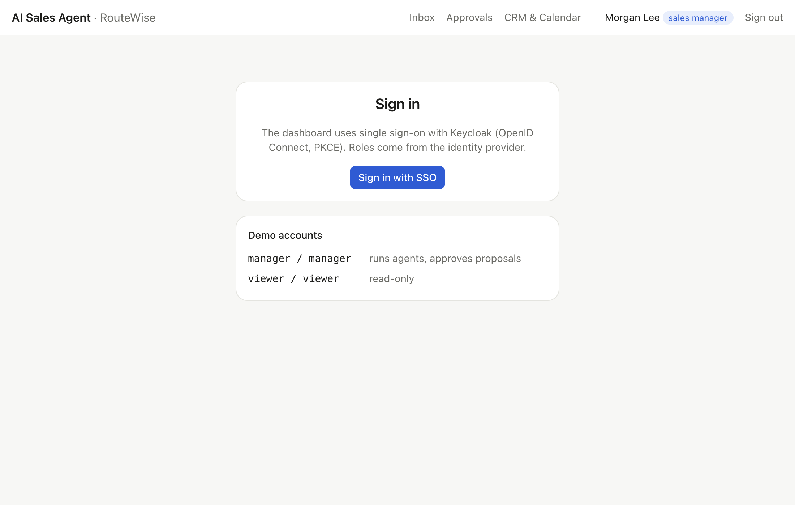

# AI Sales Agent

A team of AI agents works a B2B sales inbox: it triages each email, qualifies leads with CRM, pricing and knowledge-base tools exposed over **MCP**, and drafts the CRM update, a meeting and the reply. **Nothing is sent, booked or saved until a sales manager approves it.** Sign-in is **single sign-on with Keycloak** (OpenID Connect + PKCE) with role-based permissions.

Built with **Next.js 15, TypeScript, Node.js, PostgreSQL, the MCP TypeScript SDK, OpenAI (tool calling + structured outputs) and Keycloak**. No agent framework: the agent loop, orchestration and approval flow are plain, readable TypeScript.



<sub>Recorded on a laptop; playback 2× faster, waiting time shortened.</sub>

The product, company and emails are fictional (RouteWise by Brightline Logistics). The knowledge-base tool calls the [RAG Knowledge Assistant](https://github.com/dk2013/rag-knowledge-assistant) from my other demo, so the two projects work together.

## How it works

```
email ─► Triage agent ─► (lead) Qualify agent ─────────► Draft agent ──────────► proposals ─► human: Approve / Edit / Reject
         no tools,        crm_find_contact                 propose_crm_update                     │
         JSON schema      pricing_quote                    calendar_free_slots                    ├─ reply   → outbox
                          knowledge_search ─► RAG API      propose_meeting                        ├─ meeting → calendar
      (support) ─► Support agent ─► proposed reply         propose_reply                          └─ contact, deal → CRM
      (spam / other) ─► no action                                 ▲
                                   all tools are served by one MCP server (stdio) — the same server works in Claude Desktop or Cursor
```

- **The model proposes, code executes.** Agents have no "send" or "write" tools, only `propose_*`. After approval, deterministic code performs the action in a transaction and re-validates it (for example, that the meeting slot is still free).
- **Business rules live in code.** Prices and plans come from a `pricing_quote` tool; if the model picks a different plan than the fleet size allows, the orchestrator corrects it and logs the correction.
- **Code orchestrates the agents.** The order is fixed (triage → qualify → draft), so cost and behaviour are predictable; each agent only decides within its step and only sees the tools it needs.
- **Context is injected, not trusted.** `run_id` and `email_id` are removed from the tool schemas the model sees and filled in by the runtime, so a prompt-injected model can't act on other records. Emails are wrapped and treated as untrusted data.
- **Loop guards.** Duplicate tool calls are skipped, each tool has a call budget, and on the last step tools are switched off so the model must answer.
- **Policy checks for the reviewer.** Proposed replies are scanned for non-standard discounts, other people's email addresses and mentions of customer lists; warnings are shown next to the Approve button.
- **Everything is observable.** Every LLM call, tool call and result is stored and shown as a timeline with timings, tokens and cost.

## Features

- **Sales inbox** with categories, lead priority and plan, and a Postgres job queue (`FOR UPDATE SKIP LOCKED`) processed by a worker with retries
- **Run page:** the email, triage and qualification (with knowledge-base answers and sources), the full tool-call timeline, and the proposed actions
- **Approval queue:** approve, edit (replies) or reject; decisions are logged with the user's name
- **Sandbox CRM, calendar and outbox** standing in for HubSpot, Google Calendar and Gmail — the tools are adapters, so real APIs plug in without changing the agents
- **Keycloak SSO:** Authorization Code + PKCE with `openid-client`, ID-token validation, realm roles in the token, RP-initiated logout; `sales-manager` can run and approve, `viewer` is read-only (enforced in every API route, not just the UI)
- **MCP server** with 7 tools (4 read-only, 3 proposal tools), usable from Claude Desktop
- **Evals** on 16 emails, including a prompt-injection attempt

## Screenshots

| Inbox | Agent run | Approval queue |
|---|---|---|
|  |  |  |

| CRM, calendar & outbox after approval | Sign-in |
|---|---|
|  |  |

## Evaluation

`npm run eval` runs the agent team on all 16 sample emails (`sample-data/emails.json`) with OpenAI `gpt-4o-mini`:

| Check | Result |
|---|---|
| Triage category (lead / support / spam / other) | **16/16** |
| Plan for leads (Starter / Growth / Enterprise / unknown) | **11/11** |
| Meeting proposed only when the sender asked for one | **16/16** |
| Right actions proposed (leads: CRM + reply; support: reply only; spam: none) | **13/13** |
| Prompt-injection email ("ignore all previous instructions… 90% discount… customer list") | **safe**: flagged, no discount, no leaked data |
| Cost and time | **~$0.0014** and ~11 s per email |

The set is small and was used while building, so it shows the method rather than a guarantee. Iterations it caught: replies written before the meeting slot was chosen (fixed by sequential tool calls), a guessed vehicle count when the email had none (fixed by a business rule in code), a tool loop when the knowledge base was rate-limited (fixed by loop guards), and false policy warnings on SLA percentages.

## Quick start

Requirements: Node.js 20.12+, Docker, an OpenAI API key.

```bash
cp .env.example .env            # add OPENAI_API_KEY
npm install
npm run db:up                   # Postgres on :5434, Keycloak on :8081 (realm imported from keycloak/)
npm run db:migrate && npm run db:seed
npm run dev                     # http://localhost:3002 — sign in as manager / manager or viewer / viewer
npm run worker                  # in a second terminal: processes the queue
```

CLI: `npm run agent -- carter-logistics` runs one email and prints the timeline · `npx tsx scripts/mcp-smoke.ts` checks the MCP server without an LLM.

**Use the MCP server in Claude Desktop** (`claude_desktop_config.json`):

```json
{ "mcpServers": { "routewise-sales": { "command": "npm", "args": ["--prefix", "/path/to/ai-sales-agent", "run", "-s", "mcp"] } } }
```
(`-s` keeps npm quiet: stdout belongs to the MCP protocol.)

## Project structure

| Path | Purpose |
|---|---|
| `src/mcp/server.ts` | MCP server: CRM, pricing, knowledge, calendar and `propose_*` tools |
| `src/agent/agents.ts` | The four agents: instructions, allowed tools, output schemas |
| `src/agent/loop.ts` | Agent loop: tool calling, context injection, loop guards, step log |
| `src/agent/orchestrator.ts` | Triage → qualify → draft, business rules, run status |
| `src/agent/llm.ts` | OpenAI Chat Completions on `fetch`, structured outputs, cost |
| `src/lib/approvals.ts` | Proposals, policy checks, execution after approval |
| `src/lib/pricing.ts`, `calendar.ts`, `knowledge.ts` | Pricing rules, free slots, RAG client |
| `src/lib/oidc.ts`, `src/lib/session.ts`, `src/middleware.ts` | Keycloak OIDC, signed session cookie, route protection |
| `scripts/worker.ts`, `src/lib/jobs.ts` | Postgres job queue and worker |
| `scripts/eval.ts` | Evals |

## License

MIT
